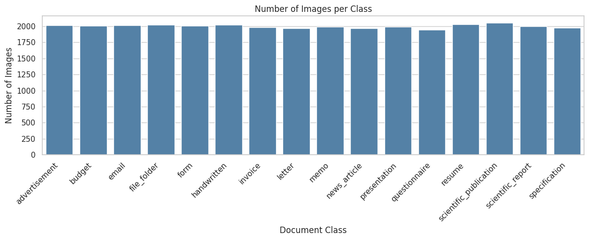
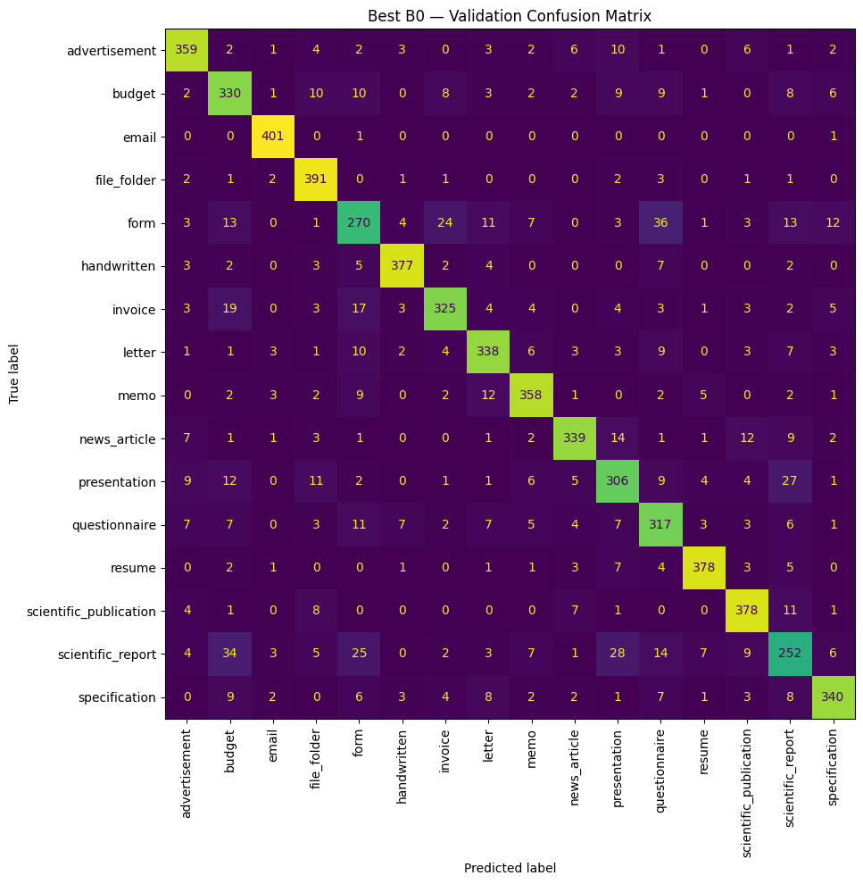

# Klasifikasi Gambar Dokumen Menggunakan EfficientNet-B0

Proyek ini mengembangkan model **klasifikasi citra dokumen ke dalam 16 kelas** menggunakan PyTorch dan EfficientNet-B0. Model dilatih dengan pendekatan _transfer learning_ dari bobot pretrained ImageNet, kemudian disesuaikan melalui _feature extraction_, _full fine-tuning_, dan _hyperparameter tuning_. Tahap akhir menggunakan **Test-Time Augmentation (TTA)** untuk meningkatkan prediksi tanpa melatih model baru.

Pengerjaan disusun mengikuti alur : **data understanding -> preprocessing -> splitting data -> baseline -> hyperparameter tuning -> training model terpilih -> evaluasi -> prediksi test**. Analisis disimpan dalam tiga notebook, sedangkan fungsi yang digunakan berulang dipisahkan ke folder `scripts/`.

| Hasil utama                          |                                Nilai |
| ------------------------------------ | -----------------------------------: |
| Model                                | EfficientNet-B0, pretrained ImageNet |
| Validation accuracy model terbaik    |                           **85,28%** |
| Validation accuracy dengan TTA 80:20 |                           **85,64%** |
| Macro F1-score dengan TTA            |                            **0,855** |

> Angka di atas adalah hasil eksperimen yang telah dijalankan, bukan jaminan hasil training ulang.

## 1. Struktur Repository

```
document-image-classification/
├── notebooks/
│   ├── 01_eda.ipynb
│   ├── 02_modeling.ipynb
│   └── 03_submission.ipynb
├── scripts/
│   ├── __init__.py
│   ├── dataset.py
│   ├── model.py
│   ├── train.py
│   ├── evaluate.py
│   └── predict.py
├── data/
│   └── .gitkeep
├── checkpoints/
│   └── .gitkeep
├── reports/
│   └── figures/
│       ├── bestmodelB0_cm.png
│       ├── bestmodelB0+TTA_cm.png
│       ├── class_distribution.png
│       └── image_dimension.png
├── submissions/
│   ├── submission_B0.csv
│   └── submission_B0_TTA.csv
├── .gitignore
├── requirements.txt
└── README.md
```

| Berkas / folder                 | Peran dalam proyek                                                                                       |
| ------------------------------- | -------------------------------------------------------------------------------------------------------- |
| `notebooks/01_eda.ipynb`        | Eksplorasi data, distribusi kelas, contoh gambar, dimensi, rasio aspek, dan pemeriksaan integritas TIFF. |
| `notebooks/02_modeling.ipynb`   | Split data, preprocessing, baseline, tuning learning rate, fine-tuning, evaluasi, serta validasi TTA.    |
| `notebooks/03_submission.ipynb` | Memuat checkpoint, melakukan inferensi test, dan membuat CSV original serta TTA.                         |
| `scripts/dataset.py`            | Loading metadata, pencarian path TIFF, transformasi gambar, stratified split, serta DataLoader.          |
| `scripts/model.py`              | Arsitektur EfficientNet-B0, classifier 16 kelas, dan pemuatan bobot ImageNet.                            |
| `scripts/train.py`              | Training/validation loop, optimizer, scheduler, checkpoint, dan resume.                                  |
| `scripts/evaluate.py`           | Memuat model dan menghitung classification report, confusion matrix, serta learning curves.              |
| `scripts/predict.py`            | Inferensi dan pembuatan submission sesuai ID pada metadata test.                                         |
| `reports/figures/`              | Dokumentasi grafik dari EDA dan evaluasi.                                                                |
| `data/`, `checkpoints/`         | Folder lokal untuk data dan bobot; isinya tidak di-commit ke GitHub.                                     |
| `submissions/`                  | Hasil CSV untuk kompetisi Kaggle.                                                                        |

Penggunaan folder `scripts/` bertujuan agar operasi utama tidak ditulis berulang dalam notebook. Fungsi dan class pada berkas `.py` diberi docstring untuk menjelaskan tujuan dan penggunaannya.

## 2. Dataset

Dataset berasal dari **kompetisi Kaggle klasifikasi gambar dokumen** yang digunakan pada praktikum ini. Setiap gambar mewakili satu jenis dokumen hasil pemindaian; berkas gambar menggunakan format **TIFF**.
[Kaggle_Competition](https://www.kaggle.com/competitions/document-image-classification-sd234504/leaderboard)

### 2.1 Isi dataset

| Berkas                   | Isi                                                                        |
| ------------------------ | -------------------------------------------------------------------------- |
| `train.csv`              | Metadata dan label data training: `id`, `filename`, `class_name`, `label`. |
| `test.csv`               | Metadata data test tanpa label: `id`, `filename`.                          |
| `sample_submission.csv`  | Contoh format submission berisi `id` dan `label`.                          |
| Folder gambar train/test | Gambar TIFF yang diacu oleh kolom `filename`.                              |

Data awal berisi **32.003 baris training** dan **7.994 baris test**. Ditemukan satu gambar training yang tidak dapat dibaca, yaitu `train/scientific_publication/2500126531_2500126536.tif`. Berkas tersebut dikecualikan oleh `load_metadata()`, sehingga **32.002 gambar valid** digunakan untuk proses modeling.

Terdapat 16 kategori: `advertisement`, `budget`, `email`, `file_folder`, `form`, `handwritten`, `invoice`, `letter`, `memo`, `news_article`, `presentation`, `questionnaire`, `resume`, `scientific_publication`, `scientific_report`, dan `specification`.

### 2.2 Cara memperoleh dataset

#### Opsi A - Kaggle Notebook

Project dapat dijalankan langsung melalui Kaggle Notebook tanpa perlu mengunduh dataset berukuran besar ke komputer lokal.

1. Buka halaman kompetisi Kaggle dan setujui aturan akses dataset jika diminta.
2. Buat atau buka notebook, lalu gunakan Add Input untuk melampirkan dataset kompetisi.
3. Siapkan modul Python dari folder `scripts/` pada repository ini. Jika menggunakan VS Code di Windows, buka terminal pada direktori utama project, kemudian jalankan:

   ```powershell
   Compress-Archive -Path scripts -DestinationPath scripts.zip -Force
   ```

Perintah tersebut akan menghasilkan `scripts.zip` yang berisi modul untuk preprocessing, training, evaluasi, dan prediksi. 4. Upload `scripts.zip` sebagai Kaggle Dataset melalui **Create New Dataset**, kemudian tambahkan dataset tersebut ke notebook menggunakan **Add Input**. 5. Upload notebook yang ingin dijalankan, yaitu `01_eda.ipynb`, `02_modeling.ipynb`, atau `03_submission.ipynb`. 6. Pada notebook modeling, aktifkan GPU melalui **Settings -> Accelerator**. Untuk notebook EDA, CPU sudah cukup. 7. Jalankan seluruh cell notebook secara berurutan. Notebook akan memuat dataset dan mengimpor fungsi dari folder `scripts/`.

**Urutan penggunaan notebook:**

- `01_eda.ipynb` - Eksplorasi dataset, pemeriksaan kualitas gambar, dan analisis distribusi kelas.
- `02_modeling.ipynb` - Training baseline, hyperparameter tuning, fine-tuning, evaluasi, dan penyimpanan checkpoint terbaik.
- `03_submission.ipynb` - Memuat checkpoint terbaik, melakukan prediksi menggunakan TTA 80:20, dan menghasilkan file CSV submission.

**Catatan:** Notebook submission tidak perlu menjalankan training ulang. Jika dijalankan pada sesi Kaggle yang berbeda, checkpoint `.pt` hasil notebook modeling harus ditambahkan sebagai Kaggle Input. Pastikan juga dataset yang dipilih sesuai dengan dataset project ini, terutama struktur file dan pemetaan labelnya.

#### Opsi B - Google Colab atau komputer lokal melalui Kaggle API.

Clone repository, instal dependensi, lalu unduh dataset menggunakan Kaggle API:

```bash
git clone https://github.com/sharlizm/document-image-classification
cd document-image-classification
python -m pip install -r requirements.txt
python -m pip install kaggle
kaggle competitions download -c document-image-classification-sd234504 -p data --unzip
```

Sebelum mengunduh dataset, pengguna perlu mengonfigurasi Kaggle API menggunakan kredensial akun masing-masing serta menyetujui aturan kompetisi jika diperlukan. Apabila hasil unduhan masih berupa arsip, ekstrak hingga file CSV dan folder gambar TIFF dapat diakses.

Struktur folder gambar harus sesuai dengan path pada kolom filename di metadata. Fungsi find_image_root() mendukung beberapa pola direktori Kaggle, termasuk train/train/... dan test/test/....

> **Catatan penyimpanan:** dataset asli berukuran besar dan **tidak disertakan di GitHub**. `.gitignore` mengabaikan isi `data/`, `checkpoints/`, dan file bobot `.pt`.

## 3. Workflow Analisis

### 3.1 Exploratory Data Analysis - `01_eda.ipynb`

EDA dilakukan sebelum modeling untuk memahami karakteristik dokumen dan menemukan potensi masalah kualitas data. Pemeriksaannya meliputi:

1. **Metadata dan kelengkapan data:** jumlah baris, tipe kolom, missing value, dan duplikasi ID.
2. **Distribusi kelas:** membandingkan jumlah sampel pada 16 kategori; distribusinya relatif seimbang sehingga accuracy masih relevan, tetapi metrik per kelas tetap dianalisis.
3. **Contoh gambar dan variasi visual:** mengamati perbedaan layout antara surat, formulir, laporan, presentasi, dan dokumen lainnya.
4. **Dimensi serta rasio aspek:** dokumen memiliki ukuran dan orientasi beragam, sehingga resize biasa dapat merusak proporsi halaman.
5. **Pemeriksaan gambar TIFF:** mendeteksi gambar yang gagal dibaca atau mempunyai metadata bermasalah.
6. **Pemeriksaan ID test dan submission:** memastikan baris pada `sample_submission.csv` sesuai dengan `test.csv`.

**Keputusan dari EDA:** gunakan _resize with padding_ agar rasio aspek dipertahankan; keluarkan gambar yang tidak terbaca; dan gunakan stratified split untuk mempertahankan perbandingan kelas pada train serta validation.



_Gambar: distribusi kelas dari analisis EDA._

Sebagian pemeriksaan TIFF dilakukan pada banyak file sehingga waktu eksekusinya bisa lebih lama.

### 3.2 Data Preparation - `02_modeling.ipynb`

Setelah gambar rusak dikeluarkan, data berlabel dibagi dengan **stratified split 80:20**, `random_state=42`:

| Subset     | Jumlah gambar | Penggunaan                                                 |
| ---------- | ------------: | ---------------------------------------------------------- |
| Training   |    **25.601** | Memperbarui bobot model.                                   |
| Validation |     **6.401** | Memilih hyperparameter dan menilai kemampuan generalisasi. |
| Test       |     **7.994** | Membuat submission; label asli tidak tersedia.             |

Seluruh eksperimen memakai split yang sama. `scripts/dataset.py` juga membuat `split_fingerprint()` dari ID validation untuk membantu mendeteksi perubahan split ketika checkpoint dimuat kembali.

**Preprocessing:** gambar dikonversi ke RGB, diubah menjadi **224 × 224 piksel** dengan padding putih, diubah menjadi tensor, kemudian dinormalisasi menggunakan mean dan standar deviasi ImageNet. Padding digunakan agar halaman tidak menjadi terdistorsi akibat perubahan rasio aspek.

**Augmentasi training:** rotasi kecil, sedikit translasi/perubahan skala, perubahan brightness dan contrast, serta Gaussian blur sesekali. Augmentasi hanya dipakai pada training; validation dan test menggunakan transformasi deterministik. Dengan cara ini, evaluasi tidak bergantung pada augmentasi acak.

### 3.3 Model dan Strategi Training

Arsitektur utama adalah **EfficientNet-B0**, yaitu _Convolutional Neural Network_ (CNN) berbasis PyTorch. Model memanfaatkan bobot pretrained ImageNet dan bagian classifier diganti menjadi **16 output kelas** dengan dropout **0,30**.

Training dilakukan dalam tiga tahap agar pengaruh strategi fine-tuning dan learning rate dapat dibandingkan:

| Tahap                           | Strategi                                                            |                Epoch | Tujuan                                                         |
| ------------------------------- | ------------------------------------------------------------------- | -------------------: | -------------------------------------------------------------- |
| Baseline (`b0_baseline`)        | Backbone dibekukan; hanya classifier dilatih.                       |                    2 | Memperoleh performa awal transfer learning.                    |
| Tuning LR rendah (`b0_lr_low`)  | Seluruh backbone dilatih; backbone LR `7e-5`, classifier LR `5e-4`. |                    2 | Menguji pembaruan bobot yang lebih konservatif.                |
| Tuning LR tinggi (`b0_lr_high`) | Seluruh backbone dilatih; backbone LR `1e-4`, classifier LR `8e-4`. |                    2 | Membandingkan konfigurasi learning rate lebih besar.           |
| Fine-tuning lanjutan            | Melanjutkan checkpoint kandidat terpilih.                           | Maks. 10 epoch total | Memperbaiki performa tanpa mengulang dua epoch percobaan awal. |

Pengaturan lain dijaga tetap agar perbandingan tuning lebih mudah diinterpretasikan:

| Parameter             | Nilai / metode                                    |
| --------------------- | ------------------------------------------------- |
| Image size            | 224 × 224                                         |
| Batch size            | 16                                                |
| Random seed           | 42                                                |
| Optimizer             | AdamW                                             |
| Weight decay          | `1e-4`                                            |
| Loss baseline         | CrossEntropyLoss                                  |
| Loss full fine-tuning | CrossEntropyLoss dengan `label_smoothing=0.05`    |
| Scheduler             | ReduceLROnPlateau berdasarkan validation accuracy |
| Gradient clipping     | Maksimum norm 1,0                                 |
| Early stopping        | 3 epoch tanpa perbaikan pada tahap lanjutan       |
| Checkpoint selection  | Validation accuracy tertinggi                     |

Setiap epoch menghasilkan **train loss, train accuracy, validation loss, dan validation accuracy**. Selama training, checkpoint `*_best.pt` diperbarui ketika validation accuracy meningkat, sedangkan `*_last.pt` menyimpan keadaan terbaru untuk melanjutkan training jika terputus. Riwayat training juga disimpan sebagai CSV.

### 3.4 Hasil Hyperparameter Tuning

Berikut hasil **run notebook modeling terbaru** pada split validation yang sama:

| Eksperimen                                   | Best validation accuracy | Keterangan                            |
| -------------------------------------------- | -----------------------: | ------------------------------------- |
| Baseline (`b0_baseline`)                     |               **62,65%** | Feature extraction selama 2 epoch.    |
| Full fine-tuning, LR rendah (`b0_lr_low`)    |               **78,02%** | Percobaan awal 2 epoch.               |
| Full fine-tuning, LR tinggi (`b0_lr_high`)   |               **79,78%** | Percobaan awal 2 epoch.               |
| **Full fine-tuning lanjutan (`b0_lr_high`)** |               **85,28%** | Hasil terbaik setelah 10 epoch total. |

Konfigurasi learning rate tinggi dipilih dari hasil percobaan awal, lalu dilanjutkan hingga epoch ke-10. Model terbaik disimpan sebagai **`b0_lr_high_best.pt`**.

Peningkatan dari baseline sampai model terpilih memperlihatkan bahwa melatih seluruh backbone lebih efektif daripada hanya melatih classifier pada dataset ini. Namun, perbandingan baseline dan full fine-tuning juga melibatkan perbedaan regularisasi; peningkatan tidak dapat diatribusikan hanya pada satu komponen.

## 4. Evaluasi Model dan Interpretasi Hasil

### 4.1 Learning Curves dan Indikasi Overfitting

Pada epoch ke-10, model terpilih mencapai:

| Metrik              |      Nilai |
| ------------------- | ---------: |
| Training accuracy   | **93,31%** |
| Validation accuracy | **85,28%** |
| Validation loss     | **0,8387** |
| Best epoch          |     **10** |

Perbedaan training dan validation accuracy sekitar **8,03 percentage points** menunjukkan adanya _generalization gap_. Validation accuracy berfluktuasi pada beberapa epoch akhir, tetapi nilai tertingginya justru terjadi pada epoch ke-10. Karena itu, hasilnya menunjukkan **risiko overfitting**, bukan bukti bahwa model terus memburuk pada validation set.

Model terbaik dipilih berdasarkan validation accuracy, bukan training accuracy atau hanya checkpoint epoch terakhir. Grafik lengkapnya tersedia pada output `02_modeling.ipynb`.

### 4.2 Classification Report dan Confusion Matrix

Evaluasi dilakukan dengan precision, recall, F1-score, serta confusion matrix pada **6.401 gambar validation**. Hasil penting sebelum TTA:

| Kelas               | F1-score B0 | Interpretasi                                                   |
| ------------------- | ----------: | -------------------------------------------------------------- |
| `email`             |       0,977 | Struktur visual relatif konsisten dan mudah dikenali.          |
| `resume`            |       0,936 | Performa baik pada dokumen dengan ciri layout yang cukup khas. |
| `handwritten`       |       0,935 | Tulisan tangan dapat dibedakan dengan baik dari dokumen cetak. |
| `presentation`      |       0,772 | Sebagian halaman mirip dengan laporan atau dokumen lain.       |
| `form`              |       0,701 | Masih sering tertukar dengan questionnaire dan invoice.        |
| `scientific_report` |       0,668 | Kelas paling menantang dalam evaluasi ini.                     |

Pada confusion matrix, `scientific_report` sering diprediksi sebagai `budget`, `presentation`, atau `form`. Demikian pula `form` dapat tertukar dengan `questionnaire` dan `invoice`. Ini mengindikasikan bahwa **kemiripan tata letak halaman** menjadi salah satu keterbatasan model berbasis visual.



_Gambar: confusion matrix model terpilih sebelum TTA._

### 4.3 Test-Time Augmentation (TTA)

Setelah model terbaik ditentukan, dilakukan pengujian **multi-scale inference** pada dua resolusi gambar menggunakan checkpoint yang sama:

- Probabilitas prediksi ukuran **224 px**: \(P\_{224}\)
- Probabilitas prediksi ukuran **256 px**: \(P\_{256}\)

Kombinasi akhirnya adalah:

```text
P_final = 0.80 × P_224 + 0.20 × P_256
prediksi = argmax(P_final)
```

Bobot TTA dibandingkan pada validation set. Hasilnya:

| Metode inferensi | Validation accuracy |
| ---------------- | ------------------: |
| Original 224 px  |            85,2835% |
| 256 px saja      |            84,2993% |
| TTA 50:50        |            85,5491% |
| TTA 70:30        |            85,6272% |
| **TTA 80:20**    |        **85,6429%** |

Metode TTA 80:20 menambah sekitar **23 prediksi benar secara bersih** dibandingkan original pada 6.401 gambar validation. Macro F1-score meningkat dari sekitar **0,851 menjadi 0,855**. Namun, kenaikan ini kecil dan bobot TTA dipilih menggunakan validation set yang sama, sehingga hasil tersebut tidak boleh dianggap jaminan peningkatan pada semua data baru.

TTA **tidak membuat bobot model baru**. Notebook submission tetap memuat `b0_lr_high_best.pt`, kemudian menghitung probabilitas dari kedua resolusi.

## 5. Panduan Menjalankan Repository

### 5.1 Kaggle - Training dan Submission

1. Buka `01_eda.ipynb` di Kaggle, lampirkan dataset kompetisi serta kode `scripts/`, kemudian jalankan EDA menggunakan CPU.
2. Buka `02_modeling.ipynb`, lampirkan input yang sama, dan aktifkan **GPU**. Pastikan bobot pretrained EfficientNet-B0 tersedia (cache atau akses Internet Kaggle).
3. Gunakan konfigurasi berikut pada cell setup untuk mereproduksi training:

   ```python
   RUN_EXPERIMENTS = True
   SEED = 42
   IMAGE_SIZE = 224
   BATCH_SIZE = 16
   ```

4. Jalankan notebook modeling **dari atas ke bawah**. Notebook akan menjalankan baseline, percobaan LR rendah dan tinggi, memilih salah satu konfigurasi, melanjutkan fine-tuning, dan mengevaluasi checkpoint terbaik.
5. Hasil checkpoint tersimpan di `/kaggle/working/checkpoints/` dan riwayat metrik di `/kaggle/working/reports/`. **Backup file `.pt` sebelum menghentikan sesi Kaggle.**
6. Buka `03_submission.ipynb` sebagai notebook terpisah, kemudian lampirkan data kompetisi, kode scripts, dan checkpoint hasil modeling sebagai Kaggle Input.
7. Jalankan notebook submission untuk menghasilkan `submission_B0.csv` dan `submission_B0_TTA.csv`. Unggah CSV yang dipilih melalui halaman kompetisi Kaggle.

**Penting:** notebook 03 menggunakan checkpoint **`b0_lr_high_best.pt`** karena itulah model pada submission yang dilaporkan. Jika pada percobaan ulang LR rendah terpilih, nama checkpoint di notebook 03 harus disesuaikan dengan hasil training tersebut.

### 5.2 VS Code - Membaca dan Mengembangkan Project

1. Clone repository dan buka folder root project menggunakan VS Code.
2. Buat environment Python dan instal dependency:

   ```bash
   python -m venv .venv
   # Aktifkan virtual environment sesuai sistem operasi
   python -m pip install -r requirements.txt
   ```

3. Buka `notebooks/01_eda.ipynb`, `02_modeling.ipynb`, dan `03_submission.ipynb` untuk membaca kode, grafik, serta laporan hasil.
4. Untuk **menjalankan** EDA, training, atau inferensi di lokal, unduh dataset terlebih dahulu ke `data/`. Untuk **melatih model dari awal**, gunakan GPU yang kompatibel dan jalankan `02_modeling.ipynb`.
5. Jika sudah mempunyai checkpoint, letakkan di `outputs/checkpoints/` atau sesuaikan lokasi checkpoint pada notebook submission.

### 5.3 Google Colab - Dataset melalui Kaggle API

1. Aktifkan **GPU runtime** di Colab.
2. Clone repository, masuk ke direktori root project, dan instal `requirements.txt`.
3. Konfigurasikan akses Kaggle API **secara privat**. Jangan menaruh token Kaggle pada cell yang akan di-commit.
4. Unduh data kompetisi melalui perintah pada bagian [2.2](#22-cara-memperoleh-dataset), pastikan folder `data/` dapat dibaca oleh `find_data_dir()`.
5. Jalankan `02_modeling.ipynb` untuk menghasilkan checkpoint sendiri, kemudian `03_submission.ipynb` untuk inferensi test.

Kaggle API hanya menyediakan dataset kompetisi yang dapat diakses oleh akun pengguna. **Checkpoint hasil training tidak ikut terunduh bersama dataset** dan harus dihasilkan sendiri atau disediakan secara terpisah.

### 5.4 Menggunakan Checkpoint yang Sudah Ada

Untuk memeriksa model yang sudah dilatih tanpa menghabiskan GPU, ubah konfigurasi modeling menjadi:

```python
RUN_EXPERIMENTS = False
CHECKPOINT_OVERRIDE = "/lokasi/checkpoints/b0_lr_high_best.pt"
```

Saat opsi ini digunakan, notebook tidak melakukan training ulang. Evaluasi dan TTA tetap memerlukan **checkpoint yang valid** serta gambar validation. File `.pt` bukan model tambahan; file ini menyimpan bobot EfficientNet-B0 dan informasi checkpoint yang dibutuhkan saat _loading_.

## 6. Reproducibility

Beberapa pengaturan dibuat konsisten agar eksperimen dapat diulang:

- **Seed 42**, stratified split 80:20, dan urutan kelas yang dibaca dari metadata.
- Preprocessing validation/test deterministik dan normalisasi ImageNet.
- Konfigurasi tiap eksperimen dicatat melalui `TrainConfig`.
- Setiap epoch melaporkan train/validation accuracy dan loss.
- `*_best.pt` menyimpan bobot terbaik berdasarkan validation accuracy; `*_last.pt` menyimpan state terakhir untuk resume.
- Checkpoint menyimpan informasi kelas dan identitas split untuk membantu mendeteksi ketidaksesuaian saat evaluasi.
- Fungsi dataset, model, training, evaluasi, dan submission tersedia di `scripts/*.py` agar kode bisa digunakan kembali.

Hasil training ulang **tidak dijamin identik hingga angka terakhir** karena perbedaan lingkungan, operasi GPU, serta stochastic augmentation. File dataset dan checkpoint besar dikecualikan dari GitHub sesuai aturan tugas.

## 7. Kesimpulan

EfficientNet-B0 dengan pretrained ImageNet dan full fine-tuning berhasil mengklasifikasikan 16 kategori dokumen dengan **validation accuracy 85,28%**. Evaluasi per kelas menunjukkan hasil baik untuk `email`, `resume`, dan `handwritten`, tetapi masih ada kesalahan pada dokumen yang memiliki struktur tampilan mirip, khususnya `scientific_report` dan `form`.

TTA dua resolusi dengan bobot **80% untuk 224 px dan 20% untuk 256 px** meningkatkan validation accuracy menjadi **85,64%**, dengan **Public Score Kaggle 0.84776**. Hasil ini menunjukkan bahwa pemilihan metode inferensi dapat meningkatkan performa tanpa mengubah bobot model.

Repository ini menyediakan alur lengkap dari EDA, preprocessing, training, tuning, evaluasi, sampai submission.
